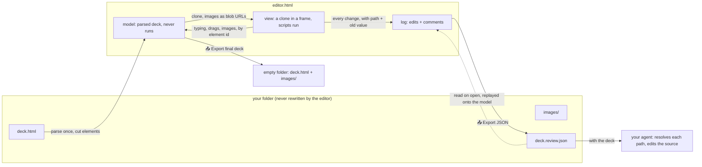

# Pinpaw · HTML deck editor

**Edit an HTML deck in your browser. Do the light edits yourself. Hand the heavy ones to your agent.**


One HTML file. No install, no build, no server, no account. Open a folder with an HTML deck in it, change the words, drag a chart, swap a logo. For anything bigger, pin a comment where it belongs and export one JSON: your agent (Claude, Codex, whichever you use) reads it, finds each element by its CSS path and original text, and does the work in the source.

```
                 you, in the browser                          your agent, in the source
   ┌──────────────────────────────────────┐          ┌────────────────────────────────────┐
   │  ✏️ text   ✋ move   🖼 image   ↶ undo │          │  "replace this chart with Q3 data"  │
   │  📌 comment: "redesign this slide"    │ ──JSON──►│  "add a slide after this one"       │
   └──────────────────────────────────────┘          │  …finds the element, edits deck.html│
              📤 Export final deck                    └────────────────────────────────────┘
              the finished deck, to present or send
```

## Try it in 30 seconds

1. Download this repository (Code → Download ZIP) and unzip it.
2. Double-click `editor.html` (Chrome or Edge).
3. Click **Open folder…** and choose the `example` folder. Allow the browser to write into it.
4. Click **✏️ Text**, click a sentence, type. Click **✋ Move**, drag the cat. Click **🖼 Image**, click the cat, pick any picture. Click **📌 Comment**, click the last slide, write "add a slide after this one".
5. Click **📤 Export JSON**. Open `example/deck.review.json`: that is what your agent gets.

## What you do, what your agent does

| You, in the editor | Your agent, from the JSON |
|---|---|
| Fix a typo, reword a sentence, change a number | Rewrite a slide's story |
| Nudge a logo, resize a chart | Redesign a layout, add or remove a slide |
| Swap an image for one on your computer | Make a new chart from new data, restyle everything to a brand |
| Pin a comment on anything above your pay grade | Carry out every comment, in the source, with a diff you can read |

The line between the two is yours to draw. The editor keeps the light side small on purpose: it will never become a slide program, because the heavy side is already covered by a tool that reads source code.

## The JSON your agent reads

Every change is one entry, with what it was and what it is now. Every comment is one entry, pinned to an element.

```json
{
  "format": "pinpaw/1",
  "deck": "deck.html",
  "reviewer": "Panda",
  "saved": "2026-11-09 14:20",
  "edits": [
    { "type": "text", "anchor": "e7", "path": "body > section.slide:nth-of-type(2) > div.row > div.card:nth-of-type(1) > p", "slide": 2, "lang": "en", "old": "less time per slide", "new": "less time per annotation", "at": "2026-11-09 14:12" },
    { "type": "move", "anchor": "e12", "path": "body > section.slide:nth-of-type(2) > div.row > div.card:nth-of-type(3) > img", "slide": 2, "old": { "move": "", "scale": "" }, "new": { "move": "24px -8px", "scale": "1.1" }, "at": "2026-11-09 14:14" },
    { "type": "image", "anchor": "e12", "path": "…", "slide": 2, "old": "images/chart.svg", "new": "images/edited-m2x1-0-q3-chart.png", "name": "q3-chart.png", "data": "data:image/png;base64,…", "at": "2026-11-09 14:15" }
  ],
  "comments": [
    { "id": 1, "anchor": "e14", "path": "body > section.slide:nth-of-type(3) > h2", "slide": 3, "what": "Heavy edits go to your agent", "pin": { "x": 0.5, "y": 0.3 }, "text": "Add a slide after this one: three customer quotes, same card style as slide 2", "at": "2026-11-09 14:18" }
  ]
}
```

Three ways to find each element, so the agent is never guessing:

- **`path`**: a CSS path from `<body>` into the file you opened, which the editor never changes. Works on the original source.
- **`old`** and **`what`**: the text or image that was there. Confirms the path landed on the right thing.
- **`anchor`**: the editor's own id (`data-eid`), present in the exported final deck. Useful when the agent works on that file instead.

A prompt that works: *"Here is `deck.html` and `deck.review.json`. Apply every comment in the source; the edits are already in the final deck, re-apply them only if you start from the original."*

## What is technically interesting here

**1. Three frames of reference for every element.** A comment is only useful if the agent can find what it points at. A pixel position breaks when the window changes; an index breaks when a slide is added. So every entry carries three references, all taken from the parsed source, never from the screen: a CSS `path` from `<body>` into the original file (`body > section.slide:nth-of-type(2) > div.card:nth-of-type(1) > p`), the `old` value that was there, and a session `anchor`. An agent resolves the path, confirms the old value, and knows it has the right element. The path is computed from the file you opened, which the editor never touches, so it stays valid however long the JSON sits in a chat.

**2. The JSON is a net-change log, and the only state.** One entry per changed thing, original to latest. Change a word three times and the log holds one entry, `old` from the first change and `new` from the last; change it back and the entry disappears. Edits and comments are kept in two lists, because they are read by different people. Because the log is complete, it is also the save file: the editor never rewrites the deck you opened; on the next open it reads the JSON and replays every edit onto a fresh parse. Undo is a stack of snapshots of the same log.

**3. Two copies of the page, and only the one that never runs is written.** The deck is parsed once into a model that never executes a script; a clone runs in a frame so the deck's own language switch and navigation keep working while you edit. Typing in the frame is written into the model by element id. Whatever the frame shows at that moment (the Chinese version, slide 7, a hover state) never reaches the output, which is the classic failure of "save the live DOM" editors.

**4. Export final deck is a derived artifact.** The finished deck is the model plus the files it references, written into an empty folder: original file + JSON → final deck. Nothing is ever edited in place, so you can always start over from the original, and the final deck carries no comments and no editor code.

**5. Cutting is deterministic.** Elements get their session ids in document order, above the highest id already present, by one rule (`touchable()`): a slide, a text element with no child tags, a multi-language text, an image, a video. The same file cuts the same way every time, which is what lets the JSON replay after a restart.

**6. One file, no server.** Folders are read and written through the File System Access API; images the deck references are shown through blob URLs; the frame has no address of its own, so `history.pushState` in the deck's scripts is guarded. Formatted paste is reduced to plain text and the `<font>` and `<span style>` tags browsers add while typing are removed, so the source stays clean.

## Why "cutting" matters

When Pinpaw opens a page it gives every element a person might touch its own id: each text, each number, each image, each slide. We call that cutting the page into elements. It is what makes a comment land on *this* number on *this* card rather than "somewhere on slide 2", and it is why the JSON can carry an exact path for every entry. Loose text next to tags (`<div>46<span>%</span></div>`) cannot be cut cleanly; `<div><span>46</span><span>%</span></div>` can.

## How it works



The editor parses the file you open into a copy that never runs, and shows a second copy in a frame where the page's own scripts do run (a language switch, slide navigation). Everything you type or drag is written into the first copy by element id, so what the frame happens to show at that moment never leaks into the output. **The file you opened is never rewritten.** 📤 Export JSON writes `<deck>.review.json` next to it, the whole record of your session; open the folder again and the editor reads it and puts every edit back. 📤 Export final deck writes the first copy, with its images, into an empty folder you choose: the finished deck, with no comments and no editor code in it.

## Multi-language decks

A deck can carry several languages in one file. Each text element holds its English as its own text and as `data-en`, and any other language as `data-<lang>`; `<body data-lang="…">` says which one is on screen, and a few lines of the deck's own script swap them. The example ships English and Chinese; add `data-ja`, `data-de` or any other code the same way.

```html
<body data-lang="en">
  <h1 data-en="A deck you can edit by hand"
      data-zh="一份可以直接改的 deck"
      data-ja="手で直せるデッキ">A deck you can edit by hand</h1>
  <button id="lang">EN / 中文 / 日本語</button>
<script>
  // the deck's own switch: show the chosen language, remember it on <body>
  const langs = ['en', 'zh', 'ja'];
  document.getElementById('lang').addEventListener('click', () => {
    const next = langs[(langs.indexOf(document.body.dataset.lang) + 1) % langs.length];
    document.body.dataset.lang = next;
    document.querySelectorAll('[data-en]').forEach(el => { el.innerHTML = el.getAttribute('data-' + next) || el.getAttribute('data-en'); });
  });
</script>
```

The editor reads `body[data-lang]` and writes what you type into that language's attribute only, so a Japanese edit never overwrites the Chinese, and the deck's switch keeps working. In the JSON the entry says which language it touched:

```json
{ "type": "text", "lang": "ja", "old": "手で直せるデッキ", "new": "手で直せるスライド", "path": "body > section.slide:nth-of-type(1) > h1" }
```

An element without `data-en` is plain text, edited once for every language (`"lang": "both"`): numbers, names, a phone number.

## Limits

- Chrome and Edge only: the editor reads and writes your folder through the File System Access API, which Safari and Firefox do not offer.
- Moves are stored as CSS `translate` / `scale` on the element, so the page's flow layout is untouched; an added image has no size or position until your agent gives it one.
- Images are capped at 5 MB each and travel inside the JSON as data URLs, so the JSON grows with them.
- Fonts and videos that the deck loads from the internet still need the internet.
- The deck's own scripts run inside the editor's page. Open decks you trust.

## In this repository

```
editor.html        the whole tool, one file: Pinpaw
example/           a three-slide deck to try it on: a cat to move or replace, numbers, a two-language toggle
docs/demo.gif      the loop above (also demo.mp4); its source is example/images/demo.svg, pure CSS
LICENSE            MIT
```

## License

MIT. Built by Elysium Panda, who got tired of fixing decks by hand and found that half the fixes were better left to the agent anyway.
